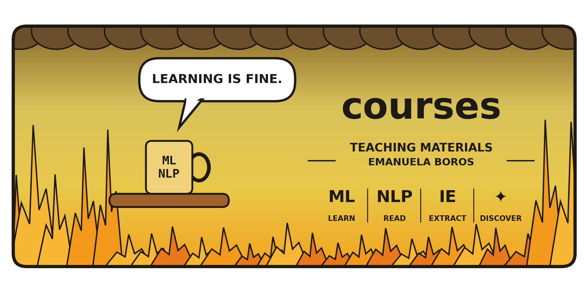
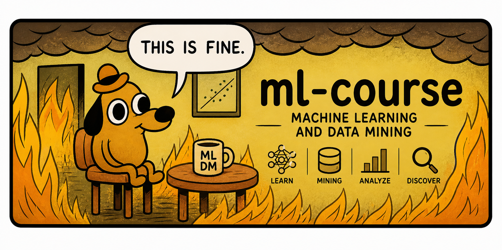
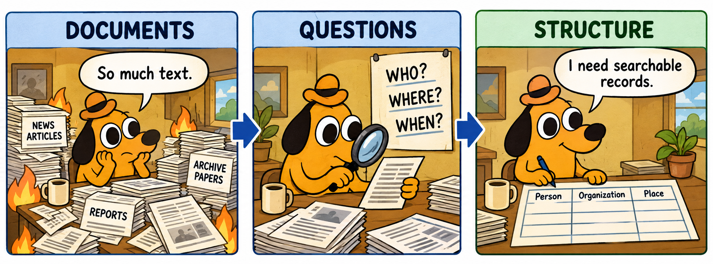

<p align="center">
  
</p>

## Welcome to my courses 🚀

**Instructor:** Assist. Prof. Emanuela Boros  

This page gathers all my classes in one place. Each course has its own website with slides, notebooks and exercises; materials are added before each session.

---

## Courses

| Course | Topic | Language | Website | Repository | Status |
|--------|-------|----------|---------|------------|--------|
| 🤖 Machine Learning | Machine Learning and Data Mining (ICT 3.3) | English | [🌐 Website](https://emanuelaboros.github.io/ml-course/) | [GitHub](https://github.com/EmanuelaBoros/ml-course) | ✅ Available |
| 💬 Natural Language Processing | From word embeddings to large language models | English | [🌐 Website](https://emanuelaboros.github.io/nlp-course/) | [GitHub](https://github.com/EmanuelaBoros/nlp-course) | ✅ Available |
| 🔎 Information Extraction | Extraction d’information : reconnaissance et liaison d’entités | Français | [🌐 Website](https://emanuelaboros.github.io/ie-course/) | [GitHub](https://github.com/EmanuelaBoros/ie-course) | ✅ Available |

---

### 🤖 Machine Learning and Data Mining

[](https://emanuelaboros.github.io/ml-course/)

The fundamentals of machine learning, from basic models to advanced concepts: regression, classification, regularization, PCA, neural networks and Bayes classification, with a group project.

[➡ Go to the Machine Learning course](https://emanuelaboros.github.io/ml-course/)

---

### 💬 Natural Language Processing

[](https://emanuelaboros.github.io/nlp-course/)

Modern NLP, from word embeddings and language models to attention, transfer learning and large language models, with seminars and homework notebooks for every week.

[➡ Go to the NLP course](https://emanuelaboros.github.io/nlp-course/)

---

### 🔎 Extraction d’information

[](https://emanuelaboros.github.io/ie-course/)

Comment transformer un texte en informations structurées ? Reconnaissance d’entités nommées (NER) et liaison à une base de connaissances (NEL), avec un TP de trois heures.

[➡ Accéder au cours d’extraction d’information](https://emanuelaboros.github.io/ie-course/)

---

## Clone a Course

Every course lives in its own repository. For example:

```bash
git clone https://github.com/EmanuelaBoros/ml-course.git
git clone https://github.com/EmanuelaBoros/nlp-course.git
git clone https://github.com/EmanuelaBoros/ie-course.git
```

---

## 💬 Contact

Assist. Prof.: *Emanuela Boros*  
Email: *emanuela.boros@univ-lr.fr*  

---

> “Tell me and I forget, teach me and I may remember, involve me and I learn.”
